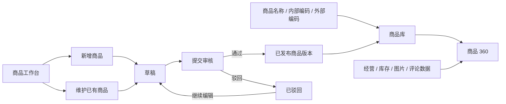
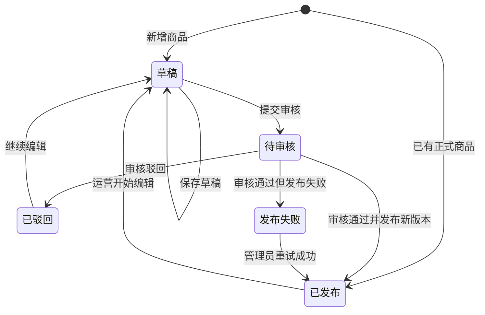

# 【PRD】商品中心 MVP V2.0

| 项目 | 内容 |
| --- | --- |
| **产品名称** | 商品中心 |
| **文档版本** | V2.0 |
| **文档状态** | 待评审 |
| **主原型** | `../../mvp_v2.html` |
| **关联原型** | `../../index.html`（商品主数据参考） `../../mvp.html`（V1 原型） |
| **产品经理** | 待定 |
| **评审日期** | 待定 |
| **目标上线时间** | 待定 |

## 变更记录

| 版本 | 日期 | 修订人 | 修订类型 | 修订内容 |
| --- | --- | --- | --- | --- |
| V1.0 | 2026-09-15 | Codex | 初稿 | 覆盖商品多模态查看、身份治理、数据问题和任务闭环的宽范围方案。 |
| V2.0 | 2026-09-16 | Codex | 范围重构 | MVP 收敛为商品检索与商品 360、单商品主数据维护、审核发布和权限审计。 |
| V2.0 | 2026-09-16 | Codex | 双工作区定稿 | 一级页面收敛为“商品库”和“商品工作台”；商品 360 为商品库二级页，商品工作台统一承载当前用户负责商品的全状态运维并支持新增商品。 |
| V2.0 | 2026-09-20 | Codex | 内容重写 | 重构业务背景、MVP 目标和核心方案；明确商品对象、双工作区、发布版本和运营闭环之间的关系，并修正新增商品与范围描述冲突。 |

## 目录

- [一、背景与产品定位](#一背景与产品定位)
- [二、MVP 目标与成功指标](#二mvp-目标与成功指标)
- [三、用户场景与核心流程](#三用户场景与核心流程)
- [四、功能模块列表](#四功能模块列表)
- [五、信息架构与页面结构](#五信息架构与页面结构)
- [六、核心功能详细设计](#六核心功能详细设计)
- [七、典型页面原型示意](#七典型页面原型示意)
- [八、权限与安全设计](#八权限与安全设计)
- [九、附录](#九附录)

---

# 一、背景与产品定位

## 1.1 业务背景

公司商品信息产生并分散在内部商品系统、渠道 Listing、销售与库存数据、图片内容和用户评论等多个来源。同一个实物商品会同时存在 SPU、SKU、UPC、EAN、ASIN、Walmart Item ID 等标识，并在不同系统中使用不同名称、规格和状态。

当前缺少一个以“公司商品”为中心的统一产品层：员工无法快速确认自己找到的是不是同一个商品，运营也缺少从新增或修改、审核到正式发布的统一工作入口。商品中心 MVP 的建设重点不是再做一个数据报表，而是先建立一条清晰的链路：**以统一商品对象组织数据，以已发布版本对全员提供可信信息，以商品工作台承载运营维护。**

### 1.1.1 现有业务链路

| 环节 | 主要角色 | 当前操作 | 直接问题 |
| --- | --- | --- | --- |
| 查找商品 | 公司员工 | 分别进入业务系统、数仓报表或渠道后台，以名称或不同编码搜索 | 入口分散；同名商品、不同规格和不同渠道编码难以辨认 |
| 了解商品 | 公司员工、管理人员 | 人工拼接主数据、销售、库存、渠道、图片和评论信息 | 数据口径、统计周期和更新时间不一致，无法快速形成商品全貌 |
| 新增与维护 | 商品运营 | 在原系统或离线表格中新增、补充或修改商品资料 | 无法统一查看自己负责商品的处理状态，草稿和正式数据边界不清 |
| 审核与发布 | 商品数据管理员 | 通过线下沟通核对修改内容，再更新正式数据 | 缺少字段级差异、审核状态和发布结果，容易漏审或重复处理 |
| 消费与追溯 | 公司员工、下游使用方 | 直接读取各系统当前数据，出现问题后再反查来源 | 无法确认哪一版是正式版本，也无法完整追溯谁在何时修改了什么 |

### 1.1.2 核心痛点拆解

| 痛点 | 具体表现 | 业务后果 |
| --- | --- | --- |
| **商品身份难定位** | 名称与内部、外部编码散落在不同系统；同一商品存在多套命名和标识 | 查找时间长，容易选错规格或把不同 Listing 当成不同商品 |
| **商品信息难看全** | 主数据、渠道经营、库存、图片和评论分别展示，缺少统一商品上下文 | 跨部门沟通仍依赖截图和人工对账，信息判断效率低 |
| **运营任务难聚合** | 待完善、草稿、待审核、驳回和已发布商品分散在不同工具或线下记录 | 负责人无法快速判断今天要处理哪些商品，任务容易遗漏 |
| **正式版本不可信** | 草稿、待审核值与正式值缺少明确隔离，字段变更没有统一审核链路 | 未确认信息可能被内部员工或下游使用，形成错误口径 |
| **变更过程难追溯** | 新增、编辑、审核、驳回和发布缺少统一记录 | 出现错误时难以定位责任人、变更字段和影响版本 |

### 1.1.3 本期要解决的核心问题

MVP 聚焦两个问题：

1. **全员如何快速找到并看懂正确的商品**：通过商品库和商品 360 提供统一检索、统一商品上下文和已发布信息。
2. **运营如何安全地新增和维护商品**：通过商品工作台集中展示本人负责的全部商品，以草稿、审核和发布机制保证正式信息可信。

完整的商品身份治理、跨渠道映射修正和数据问题任务中心不在本期解决；MVP 先建立“可查、可看、可维护、可审核、可追溯”的最小闭环。

## 1.2 产品定位

商品中心是以统一商品对象为核心的公司级商品信息入口：面向全员提供可信的商品检索与商品 360，面向运营和管理员提供受控的商品新增、维护、审核与发布工作台。

### 1.2.1 核心价值

- **统一商品入口 + 缩短定位路径**：名称、SPU、SKU 和外部编码均可定位同一商品对象；
- **多维信息聚合 + 降低核对成本**：商品 360 在同一上下文展示主数据、渠道经营、库存、图片和评论摘要；
- **责任商品聚合 + 提高运营处理效率**：商品工作台汇总当前用户负责的全部商品及处理状态；
- **草稿审核发布 + 保证正式信息可信**：编辑过程与全员可见版本隔离，所有关键变更可追溯。

### 1.2.2 目标用户

| 用户角色 | 核心诉求 | MVP 优先级 |
| --- | --- | --- |
| **公司员工** | 快速搜索商品并查看可信的多维信息 | P0 |
| **商品运营** | 查看并编辑负责商品的标准主数据，提交审核 | P0 |
| **商品数据管理员** | 审核运营提交的主数据变更并发布正式版本 | P0 |
| **平台管理员** | 配置角色和商品范围权限，追踪关键操作 | P0 |

## 1.3 核心产品判断

| 产品判断 | 设计结论 | 原因 |
| --- | --- | --- |
| 产品围绕什么组织 | **围绕商品对象组织，而不是围绕数据源或渠道页面组织** | 用户先确认“是哪一个商品”，再查看该商品在不同渠道和数据维度的表现 |
| 查看与维护是否放在同一页面 | **拆分为商品库和商品工作台两个一级页面** | 全员查看追求简单可信；运营维护需要状态、任务和操作，两者信息密度与权限不同 |
| 商品 360 的层级 | **商品库的二级详情页，不作为一级菜单** | 商品 360 必须依附一个明确商品上下文，用户应先搜索或选择商品 |
| 全员看到哪一版 | **只展示当前已发布版本** | 草稿和待审核数据尚未确认，不能影响公司统一口径 |
| 运营从哪里工作 | **商品工作台展示当前用户负责或待其审核的全部状态商品** | 运营按责任和状态完成任务，不需要在多个菜单间切换 |
| 本期是否做完整身份治理 | **不做人工映射、合并、拆分和纠错工作台** | 本期优先验证商品信息消费与主数据维护闭环；高风险身份操作后续独立建设 |

## 1.4 MVP 范围边界

| 维度 | MVP V2 范围 |
| --- | --- |
| 商品范围 | 已发布的存量 SPU/SKU，以及由商品工作台新增并经审核发布的商品 |
| 用户范围 | 公司员工可检索和查看；商品运营可编辑授权商品；商品数据管理员可审核发布 |
| 查看内容 | 已发布主数据、变体、关联编码、渠道经营、库存、商品图片和评论摘要 |
| 运维内容 | 单商品新增；标准名称、品牌、类目、型号、状态、生命周期、上市日期、标准卖点、类目规格、包装与配件维护 |
| 版本机制 | 草稿、待审核、已驳回、已发布和发布失败；审核发布后形成新的当前生效版本，历史版本保留 |
| 数据时效 | 主数据实时展示已发布版本；经营、库存、图片和评论按各数据源时效展示数据日期 |
| 明确不做 | 批量新建/编辑、商品删除、身份关系修改、渠道内容回写、图片素材管理和评论治理 |

---

# 二、MVP 目标与成功指标

## 2.1 MVP 核心目标

1. **让员工找得到正确商品**：支持通过商品名称、SPU、SKU 和已关联外部编码定位有权限查看的商品，搜索后进入商品 360 的成功率达到 85% 以上。
2. **让员工在一处看懂商品**：试点范围内 90% 以上商品可展示已发布主数据及至少三个多维信息模块，并明确来源和数据日期。
3. **让运营在一处完成日常运维**：当前用户负责商品的新增、完善、草稿、审核、驳回和已发布状态均在商品工作台可查看和推进，线上主数据变更占比达到 80% 以上。
4. **让正式商品信息可信且可追溯**：草稿和待审核信息不进入商品库及正式下游；审核通过后的发布成功率达到 99% 以上，新增、编辑、审核和发布均保留字段级记录。

## 2.2 成功指标

| 指标名称 | 核心定义 | 目标值 | 统计维度 |
| --- | --- | --- | --- |
| 商品检索成功率 | 搜索后打开商品 360 的会话数 ÷ 发起有效搜索的会话数 | ≥85% | 周、搜索类型 |
| 商品 360 可用覆盖率 | 可展示已发布主数据及至少 3 个信息维度的商品数 ÷ 已接入商品数 | ≥90% | 日、品牌、类目 |
| 周活跃查看用户数 | 一周内查看至少 1 个商品 360 的去重员工数 | ≥300 | 周、部门 |
| 运营线上编辑占比 | 在商品中心完成的主数据变更数 ÷ 全部主数据变更数 | ≥80% | 月、品牌 |
| 主数据审核周期 | 从提交审核到审核完成的中位时长 | ≤1 个工作日 | 周、审核人 |
| 发布成功率 | 审核通过且成功形成已发布版本的次数 ÷ 审核通过次数 | ≥99% | 日、月 |
| 新增商品首次发布成功率 | 新增商品首次审核通过并成功生成正式版本的数量 ÷ 首次审核通过数量 | ≥95% | 月、品牌、类目 |

> 指标目标以试点上线后连续 4 周为首个观察周期；若全员规模或试点商品范围调整，周活跃用户数目标须在评审时同步修订。

## 2.3 上线门槛

| 门槛 | 验收条件 | 未达标处理 |
| --- | --- | --- |
| 商品身份 | SPU、SKU 与外部编码关系可唯一定位商品 | 存在冲突的商品不开放编辑 |
| 主数据字段 | 必填字段、枚举值和类目属性模板完成确认 | 对应类目仅开放查看 |
| 多维数据 | 每个试点商品至少接入主数据和 3 个详情维度 | 页面明确显示未接入维度 |
| 权限 | 全员查看、运营编辑、管理员审核均通过服务端鉴权 | 不允许上线编辑功能 |
| 版本发布 | 草稿不进入正式视图，审核通过后可生成新版本 | 不允许运营提交正式变更 |
| 审计 | 编辑、提交、审核、驳回和发布均生成审计记录 | 不允许上线编辑功能 |

---

# 三、用户场景与核心流程

## 3.1 用户故事

| 角色 | 我希望... | 以便... | 优先级 |
| --- | --- | --- | --- |
| 公司员工 | 按商品名称、SPU、SKU 或外部编码搜索商品 | 快速定位正确商品 | P0 |
| 公司员工 | 在商品 360 查看主数据、渠道、经营、图片和评论摘要 | 在一个页面了解商品全貌 | P0 |
| 公司员工 | 查看每个模块的数据日期和来源 | 判断信息是否可信和新鲜 | P0 |
| 商品运营 | 在商品工作台查看我负责的全部商品，并按状态推进处理 | 不在多个菜单间切换即可完成日常运维 | P0 |
| 商品运营 | 新增商品并保存为草稿 | 为尚未进入商品库的商品建立标准主数据 | P0 |
| 商品运营 | 编辑负责商品、保存草稿并提交审核 | 在不影响正式版本的前提下维护准确的标准商品信息 | P0 |
| 商品数据管理员 | 对比变更前后值并审核 | 阻止错误数据进入全员视图和下游 | P0 |
| 平台管理员 | 查看主数据操作记录 | 对关键变更进行追溯 | P0 |

## 3.2 核心方案总览

### 3.2.1 方案组成

| 方案层 | 核心设计 | 解决的问题 | MVP 输出 |
| --- | --- | --- | --- |
| 商品对象层 | 以 SPU 为商品主对象，关联 SKU、外部编码和各数据维度 | 同一商品在不同系统和渠道中难以定位 | 可由名称、内部编码或外部编码回到同一商品上下文 |
| 信息消费层 | 商品库提供全员检索；商品 360 展示一个商品的已发布信息 | 商品信息分散、口径不一致 | 全员只读的统一商品目录和多维详情 |
| 运营作业层 | 商品工作台按当前用户责任范围汇总全部状态商品 | 运营任务分散、处理状态不透明 | 新增、完善、编辑、审核和追溯的统一入口 |
| 版本控制层 | 正式版本、草稿和审核单隔离；审核通过后发布新版本 | 未确认修改影响正式信息 | 商品库始终读取当前已发布版本，旧版本可追溯 |
| 权限审计层 | 查看、编辑、审核按角色和商品范围鉴权；关键操作留痕 | 越权修改和责任不清 | 服务端权限校验及字段级变更记录 |

### 3.2.2 两条主链路

**方案关系**：商品库是全员的信息消费入口；商品工作台是运营和管理员的作业入口；商品 360 是商品库的二级详情页；商品编辑/新增页是工作台的二级作业页。两个一级页面共享同一个商品对象，但读取不同版本和提供不同权限。

### 3.2.3 核心数据与状态模型

| 概念 | 定义 | 页面表现 |
| --- | --- | --- |
| 商品对象 | 公司内部统一识别的商品实体，以 SPU 聚合 SKU、外部编码和多维数据 | 商品库一行对应一个 SPU；进入商品 360 后固定该商品上下文 |
| 当前已发布版本 | 最新一次审核通过且发布成功的主数据快照 | 商品库和商品 360 只读取该版本 |
| 活动草稿 | 运营新增或修改中的版本，不影响当前已发布版本 | 仅在商品工作台和编辑页对有权限用户可见 |
| 流程状态 | 草稿、待审核、已驳回、已发布、发布失败 | 决定商品可执行的编辑、审核和查看操作 |
| 完整度状态 | 根据必填字段与类目属性计算的质量结果，如“待完善” | 是独立于流程状态的质量标签；已发布商品也可能处于待完善状态 |
| 责任关系 | 负责人、协作人和审核人对商品形成的任务关系 | 决定商品是否进入当前用户的商品工作台及可执行操作 |

## 3.3 核心流程一：检索并查看商品

| 步骤 | 操作人 | 动作 | 系统结果 |
| --- | --- | --- | --- |
| 1 | 公司员工 | 进入商品库或使用顶部全局搜索 | 展示用户有权限查看的已发布商品 |
| 2 | 公司员工 | 输入名称、SPU、SKU、UPC、EAN、ASIN 或 Item ID | 返回匹配商品，并标记命中的编码类型 |
| 3 | 公司员工 | 选择商品 | 打开商品 360，固定当前 SPU/SKU 上下文 |
| 4 | 公司员工 | 切换基础与规格、渠道与经营、图片与内容、评论与口碑 | 展示对应维度、数据来源和数据日期 |
| 5 | 公司员工 | 返回商品库 | 恢复进入详情前的筛选、排序和分页 |

## 3.4 核心流程二：编辑并发布已有商品

| 步骤 | 操作人 | 动作 | 系统结果 |
| --- | --- | --- | --- |
| 1 | 商品运营 | 从商品库行操作或商品 360 点击“编辑主数据” | 校验编辑权限；进入该商品编辑页并基于当前已发布版本创建或打开草稿 |
| 2 | 商品运营 | 修改字段并填写变更说明 | 实时校验必填、枚举、格式和类目属性规则 |
| 3 | 商品运营 | 保存草稿 | 保存未提交版本；仅本人及有权限运营可见 |
| 4 | 商品运营 | 点击“提交审核” | 再次校验所有字段；状态变为“待审核”，禁止继续编辑 |
| 5 | 商品数据管理员 | 查看字段级变更对比并通过或驳回 | 通过后生成新已发布版本；驳回后状态变为“已驳回”并记录原因，运营点击“继续编辑”后回到草稿 |
| 6 | 系统 | 发布成功 | 新版本成为当前已发布版本；商品库、商品 360 和正式下游读取新值，旧版本保留 |

## 3.5 核心流程三：新增商品

| 步骤 | 操作人 | 动作 | 系统结果 |
| --- | --- | --- | --- |
| 1 | 商品运营 | 在商品工作台点击“新增商品” | 打开空白新增页，不带入任何已有商品字段 |
| 2 | 商品运营 | 填写标准名称、品牌、类目、型号、负责人和关键规格 | 系统实时校验必填项、类目属性和疑似重复商品 |
| 3 | 商品运营 | 保存草稿 | 生成临时商品 ID；草稿仅在有权限用户的商品工作台可见 |
| 4 | 商品运营 | 补齐信息并提交审核 | 再次校验全部必填项及疑似重复商品；状态变为待审核并锁定编辑 |
| 5 | 商品数据管理员 | 审核通过 | 按公司编码规则生成正式 SPU 和首个 SKU，发布 V1，并进入商品库和商品 360 |
| 6 | 商品数据管理员 | 审核驳回 | 记录驳回原因；商品进入负责人“已驳回”视图，可继续编辑 |

## 3.6 主数据状态流转

> “待完善”不参与上述流程流转。它是由完整度规则计算出的质量状态，可与“草稿”“待审核”或“已发布”等流程状态同时存在。

---

# 四、功能模块列表

## 4.1 MVP V2 功能

| 模块 | 功能 | MVP | 优先级 | 说明 |
| --- | --- | --- | --- | --- |
| **商品库** | 商品名称、SPU、SKU 和外部编码搜索 | ✅ | P0 | 面向公司全员的唯一商品目录入口 |
|  | 品牌、类目、状态、市场筛选和分页 | ✅ | P0 | 仅返回用户可查看商品 |
|  | 商品摘要、生命周期、完整度和更新时间展示 | ✅ | P0 | 仅展示当前已发布版本 |
| **商品 360** | 商品头部、主数据状态和多维摘要 | ✅ | P0 | 统一商品上下文 |
|  | 基础与规格 | ✅ | P0 | 已发布主数据只读展示 |
|  | 渠道与经营 | ✅ | P0 | 价格、销量、GMV、库存、评分及数据日期 |
|  | 图片与内容 | ✅ | P1 | 图片只读预览，不做素材管理 |
|  | 评论与口碑 | ✅ | P1 | 评分、情绪和主题摘要 |
| **商品工作台** | 当前用户负责的全部商品 | ✅ | P0 | 仅运营和管理员可见；统一列表按状态筛选 |
|  | 全部、待完善、草稿、待审核、已驳回、已发布状态视图 | ✅ | P0 | 页内 Tab；待完善是质量视图；发布失败在全部视图中以异常状态展示 |
|  | 新增商品 | ✅ | P0 | 创建单商品草稿，审核发布后进入商品库 |
|  | 变更记录 | ✅ | P0 | 工作台内辅助视图 |
| **商品编辑/新增页** | 基本信息编辑 | ✅ | P0 | 从商品库、商品 360 或商品工作台进入，不设独立一级菜单 |
|  | 类目规格编辑 | ✅ | P0 | 字段来源于类目属性模板 |
|  | 包装与配件编辑 | ✅ | P0 | 结构化维护数量与单位 |
|  | 变体和外部编码查看 | ✅ | P0 | **MVP 只读，不允许修改关系** |
|  | 保存草稿、提交审核 | ✅ | P0 | 草稿与已发布版本隔离 |
|  | 审核通过、驳回和发布 | ✅ | P0 | 商品数据管理员操作 |
|  | 变更历史和字段级差异 | ✅ | P0 | 支持按版本追溯 |
| **权限与审计** | 全员查看、运营编辑、管理员审核 | ✅ | P0 | 服务端鉴权 |
|  | 编辑、提交、审核、驳回、发布记录 | ✅ | P0 | 审计不可由普通用户删除 |

## 4.2 非本期范围

| 能力 | 原因 |
| --- | --- |
| 商品身份治理和 Listing-SKU 人工映射 | V2 先验证全员查看与主数据编辑主链路 |
| 数据问题和任务中心 | 不属于本次两条核心主线 |
| 主数据批量导入、批量编辑 | 首期先控制单商品变更风险 |
| 批量新建商品；删除、合并或拆分 SPU/SKU | MVP 仅支持单商品新增，复杂身份治理另行设计 |
| 修改 SPU、SKU、ASIN、Item ID 等身份关系 | 身份关系变更风险高，MVP 只读 |
| 渠道内容发布与回写 | 涉及外部平台写操作和回滚 |
| 商品图片上传、审核和版本管理 | V2 仅提供图片只读查看 |
| 评论治理、AI 问商品、问题与任务闭环 | 数据和产品范围后续单独规划 |

---

# 五、信息架构与页面结构

## 5.1 整体布局与宿主

- **模块定位**：商品中心属于 **RootData → 数据应用**，提供公司级商品目录、商品 360 和主数据维护能力。
- **一级页面仅保留两个**：面向全员的“商品库”和面向商品运营/管理员的“商品工作台”。普通员工只看到商品库。
- **商品库**：全员统一商品目录和默认首页；商品 360 是从商品库选择商品后的二级详情页，不作为左侧一级菜单，也不默认打开最近商品。
- **商品工作台**：汇总当前用户负责、协作或待其审核的商品；“全部、待完善、草稿、待审核、已驳回、已发布、变更记录”均为页内视图，不再拆成多个侧栏页面。其中“待完善”是质量视图，可与流程状态重叠。
- **商品编辑/新增页**：商品工作台的对象下钻页，不作为左侧菜单；已有商品也可由商品库或商品 360 的“编辑主数据”进入。
- **全员主路径**：商品库 / 全局搜索 → 商品 360 → 多维只读信息。
- **运营主路径**：商品工作台 → 按状态筛选 → 商品编辑页 → 保存草稿 / 提交审核 → 审核发布；或在工作台点击“新增商品”创建商品草稿。
- **复用能力**：复用 RootData 用户、组织、权限、表格、筛选、分页、抽屉、消息和审计能力。
- **自研边界**：统一商品搜索、商品 360 聚合、主数据表单、版本状态和审核发布业务规则。

## 5.2 商品库

| 维度 | 说明 |
| --- | --- |
| 受众 | 公司全员 |
| 列表列 | 商品缩略图、名称、SPU、品牌/类目、生命周期、状态、市场、SKU 数、渠道数、完整度、最近更新时间、操作 |
| 筛选 | 关键词、品牌、类目、商品状态、市场 |
| 排序 | 默认按最近更新时间倒序；支持按商品名称和完整度排序 |
| 操作 | 所有人可“查看 360”；有权限运营显示“编辑主数据” |
| 数据边界 | 仅展示已发布版本；无权限商品不返回 |

## 5.3 商品 360

| 维度 | 说明 |
| --- | --- |
| 受众 | 公司全员 |
| 商品头部 | 商品名称、SPU、品牌、类目、负责人、状态、主图 |
| 页签 | 商品 360、基础与规格、渠道与经营、图片与内容、评论与口碑 |
| 数据状态 | 每个模块显示数据日期、来源、未接入或延迟状态 |
| 操作 | 有权限运营显示“编辑主数据”；普通员工不显示编辑入口 |

## 5.4 商品编辑/新增页

| 维度 | 说明 |
| --- | --- |
| 受众 | 商品运营、商品数据管理员；普通员工无编辑页入口 |
| 入口 | 商品库行内“编辑主数据”、商品 360 头部“编辑主数据”及商品工作台各状态视图 |
| 导航 | 基本信息、规格属性、变体、包装与配件、关联编码、变更历史 |
| 查看状态 | 草稿、待审核、已驳回、已发布和发布失败；待完善作为可叠加的质量状态 |
| 编辑方式 | 右侧抽屉编辑单商品字段；支持保存草稿和提交审核 |
| 只读内容 | 已有商品的 SPU、SKU、变体关系和渠道外部编码 |
| 审核 | 展示字段级变更前后值、变更说明、操作人和提交时间 |

## 5.5 商品工作台

| 维度 | 说明 |
| --- | --- |
| 受众 | 商品运营、商品数据管理员；普通员工不可见导航和页面 |
| 默认范围 | 当前用户作为负责人、协作人或审核人的全部商品，覆盖草稿、待审核、已驳回、已发布和发布失败等流程状态 |
| 状态视图 | 全部、草稿、待审核、已驳回、已发布为主要流程状态视图；待完善为可重叠的质量视图；发布失败在全部视图以异常状态展示并可筛选 |
| 新增商品 | 页面右上角主按钮；进入新增商品页，保存后生成临时商品 ID |
| 变更记录 | 工作台内辅助视图；按商品、版本、操作人、操作类型、结果和时间追溯 |
| 下钻 | 列表行进入同一个商品编辑/审核页，并保留来源状态、筛选和分页 |

## 5.6 页面/弹窗清单

| 页面/组件 | 类型 | 说明 |
| --- | --- | --- |
| 商品库 | 一级整页 | 全员商品检索与商品 360 入口 |
| 商品 360 | 整页 + Tab | 商品多维只读详情 |
| 商品工作台 | 一级整页 + 状态 Tab | 当前用户负责商品的全状态运维、审核和新增入口 |
| 变更记录 | 工作台内视图 | 按商品和版本追溯主数据变更 |
| 商品编辑/新增页 | 二级整页 + 左侧锚点 | 具体商品的主数据查看、编辑或新增；不是左侧一级模块 |
| 编辑主数据 | 侧边抽屉 | 编辑字段、保存草稿、提交审核 |
| 审核单 | 整页或侧边抽屉 | 管理员查看字段差异并通过或驳回 |
| 驳回确认 | 弹窗 | 必填驳回原因，确认后进入已驳回状态 |
| 离开未保存确认 | 弹窗 | 存在未保存修改时阻止直接离开 |

---

# 六、核心功能详细设计

## 6.1 商品库与搜索

### 6.1.1 入口与交互

用户进入商品中心后默认打开商品库；顶部全局搜索在商品库、商品 360 和商品编辑/新增页持续可用。

### 6.1.2 页面分区

| 模块分区 | 功能描述 |
| --- | --- |
| 搜索区 | 1. 关键词：文本搜索【已发布商品名称、SPU、SKU、UPC、EAN、ASIN、Item ID】默认值为空。 2. 完整编码优先精确匹配；名称支持模糊匹配。 3. 结果仅包含当前用户有查看权限的商品。 |
| 筛选区 | 1. 品牌：下拉多选框【已发布商品品牌】默认全选。 2. 类目：级联选择器【商品类目树】默认无。 3. 商品状态：下拉多选框【筹备/在售/停售】默认全选。 4. 市场：下拉多选框【商品覆盖市场】默认全选。 |
| 列表区 | 1. 展示商品缩略图、名称、SPU、品牌/类目、生命周期、状态、市场、SKU 数、渠道数、完整度和更新时间。 2. 默认按更新时间倒序。 3. 默认每页 20 条，支持 20/50/100 条。 |
| 操作区 | 1. 查看 360：所有有查看权限的用户可操作。 2. 编辑主数据：仅对有当前商品编辑权限的运营显示。 3. 返回列表时恢复筛选、排序、页码和滚动位置。 |
| 异常状态 | 1. 无结果：显示“未找到商品”并提供清除筛选。 2. 无权限：不返回商品；直接访问时展示无权限页。 3. 数据延迟：显示最近成功更新时间，不以 0 替代。 |

### 6.1.3 验收标准

| 编号 | 验收条件 |
| --- | --- |
| AC-LIST-01 | 输入完整 SPU、SKU 或已关联外部编码后，对应商品出现在结果第一项。 |
| AC-LIST-02 | 普通员工的列表和搜索结果不出现草稿、待审核版本或编辑入口。 |
| AC-LIST-03 | 品牌、类目、状态和市场同时选择时按“且”关系过滤，结果总数与分页一致。 |
| AC-LIST-04 | 从商品 360 返回后保留进入详情前的筛选、排序、页码和滚动位置。 |
| AC-LIST-05 | 无权限商品不出现在搜索结果中，直接访问详情时服务端拒绝。 |

## 6.2 商品 360

### 6.2.1 入口与交互

从商品库“查看 360”或全局搜索结果进入。页面固定当前商品上下文，所有页签读取同一 SPU/SKU。

### 6.2.2 页面分区

| 模块分区 | 功能描述 |
| --- | --- |
| 商品头部 | 1. 展示主图、标准商品名、SPU、品牌、类目、负责人和状态。 2. 数据来源为当前已发布主数据版本。 3. 有编辑权限时显示“编辑主数据”。 |
| 商品 360 | 1. 展示 SKU 数、近 30 天 GMV、可售库存、评分和评论数。 2. 展示渠道状态和主数据版本状态。 3. 每项经营指标显示统计周期与数据日期。 |
| 基础与规格 | 1. 展示标准名称、品牌、类目、型号、生命周期、核心规格、包装和关联编码。 2. 全部字段只读。 |
| 渠道与经营 | 1. 按渠道展示外部编码、状态、价格、销量、GMV、库存、评分和评论数。 2. 无数据与数值 0 必须区分。 |
| 图片与内容 | 1. 展示已关联渠道图片缩略图和数量。 2. MVP 仅预览，不支持上传、删除和审核。 |
| 评论与口碑 | 1. 展示总体评分、评论量、情绪占比及正负面主题。 2. MVP 不提供评论治理和 AI 问答。 |
| 数据状态 | 1. 每个维度显示来源、最近成功数据日期。 2. 未接入显示“未接入”；超过 SLA 显示“数据延迟”。 |

### 6.2.3 验收标准

| 编号 | 验收条件 |
| --- | --- |
| AC-360-01 | 从列表选择商品后，商品头部 SPU 与所选行一致，切换页签时上下文不变。 |
| AC-360-02 | 普通员工看到的主数据版本号与当前已发布版本一致。 |
| AC-360-03 | 未接入模块显示“未接入”，有数据但值为 0 时显示数值 0。 |
| AC-360-04 | 每个经营、库存、图片和评论模块均显示数据日期。 |
| AC-360-05 | 普通员工不显示编辑按钮；有权限运营点击编辑后进入同一商品草稿。 |

## 6.3 商品工作台

### 6.3.1 入口与交互

商品运营和商品数据管理员登录后在左侧看到“商品工作台”。工作台默认展示当前用户作为负责人、协作人或审核人的全部商品，并通过页内状态 Tab 切换处理范围；普通员工不显示入口，直接访问时服务端拒绝。页面右上角提供“新增商品”。

### 6.3.2 状态视图

| 状态视图 | 数据范围 | 默认排序 | 行操作 |
| --- | --- | --- | --- |
| 全部 | 当前用户负责、协作或待审核的全部商品；同一商品只出现一次 | 待处理优先 → 更新时间倒序 | 根据状态显示完善、继续编辑、审核或查看 |
| 待完善商品 | 用户有维护权限，且完整度未达标的商品；可与草稿、待审核或已发布视图重叠 | 影响在售商品优先 → 完整度升序 → 更新时间倒序 | 完善商品、查看 360 |
| 草稿 | 当前用户负责且状态为“草稿”的商品版本，包含新增商品草稿 | 最近保存时间倒序 | 继续编辑、放弃草稿 |
| 待审核 | 当前用户负责的待审核版本，以及分配给当前用户审核且提交人非本人的版本 | 超时优先 → 提交时间升序 | 查看进度或审核、查看 360 |
| 已驳回 | 当前用户提交且审核结果为驳回的草稿 | 驳回时间倒序 | 查看原因、继续编辑 |
| 已发布 | 当前用户负责且已有正式发布版本的商品 | 最近发布时间倒序 | 查看 360、发起编辑 |
| 发布失败 | 当前用户负责或有管理权限，且审核通过后发布未成功的商品；不单设顶部 Tab，通过“全部”的状态筛选查看 | 失败时间倒序 | 查看失败原因、管理员重试 |
| 变更记录 | 用户有查看权限的商品主数据编辑、提交、审核和发布记录 | 操作时间倒序 | 查看版本、查看字段差异 |

### 6.3.3 页面分区

| 模块分区 | 功能描述 |
| --- | --- |
| 指标区 | 1. 展示我负责的商品、待完善、草稿/已驳回、待我审核数量。 2. 点击指标进入对应状态视图。 3. 数量按当前用户权限实时统计。 |
| 页面操作 | 1. “新增商品”为主操作，进入新增商品页。 2. “查看变更记录”切换到变更记录视图。 |
| 筛选区 | 1. 关键词：文本搜索【商品名称、SPU、版本、负责人】默认值为空。 2. 品牌：下拉多选框【品牌主数据】默认全选。 3. 负责人：搜索多选框【组织用户】默认当前用户负责范围。 4. 流程状态：下拉多选框【草稿/待审核/已驳回/已发布/发布失败】默认全选。 5. 时间范围：日期范围选择器【创建/提交/操作时间】默认近 30 天。 |
| 列表区 | 1. 通用字段：商品、版本、负责人/提交人、当前状态、变更或缺失摘要、更新时间。 2. 待我审核额外展示提交时间和 SLA；变更记录额外展示操作类型与结果。 3. 默认每页 20 条。 |
| 操作区 | 1. 按状态显示完善、继续编辑、审核、查看原因或查看版本。 2. 进入商品编辑页后记录来源状态。 3. 返回时恢复来源状态、筛选、排序和页码。 |
| 异常状态 | 1. 无权限：不展示商品工作台导航。 2. 空状态：展示对应完成态文案，不跳回其他页面。 3. 任务已被他人处理：刷新状态并提示最新处理人和时间。 |

### 6.3.4 验收标准

| 编号 | 验收条件 |
| --- | --- |
| AC-WB-01 | 左侧仅展示“商品库”和“商品工作台”两个一级入口；普通员工不显示商品工作台，直接访问时服务端拒绝。 |
| AC-WB-02 | 工作台“全部”视图包含当前用户负责、协作或待审核的各流程状态商品，且同一商品只出现一次；“待完善”因可与流程状态重叠，不要求与其他 Tab 数量相加等于全部。 |
| AC-WB-03 | “待审核”中当前用户作为审核人时，不返回当前用户本人提交且需要本人审核的版本。 |
| AC-WB-04 | 从任一状态进入商品编辑页并返回后，来源状态、筛选、排序和页码保持不变。 |
| AC-WB-05 | 记录被其他用户处理后，当前用户执行操作时系统阻止重复处理并展示最新状态。 |
| AC-WB-06 | 点击“新增商品”进入空白新增页，不复用任何已有商品的已发布字段值。 |

## 6.4 商品编辑/新增页

### 6.4.1 入口与交互

商品编辑/新增页不提供独立左侧入口。商品运营可从商品库、商品 360 或商品工作台进入已有商品编辑，也可从工作台点击“新增商品”进入空白表单；商品数据管理员从待审核或变更记录进入审核/查看状态。页面返回时恢复来源页面上下文。

### 6.4.2 字段与编辑规则

| 模块分区 | 功能描述 |
| --- | --- |
| 基本信息 | 1. 标准商品名称：文本输入框【当前商品】必填；编辑时默认当前已发布值，新增时为空。 2. 品牌：下拉单选框【品牌主数据】必填；编辑时默认当前值，新增时无默认。 3. 类目：级联选择器【商品类目树】必填；编辑时默认当前值，新增时无默认。 4. 型号：文本输入框【当前商品】必填；编辑时默认当前值，新增时为空。 5. 商品状态：下拉单选框【筹备/在售/停售】必填；编辑时默认当前值，新增时默认“筹备”。 6. 生命周期：下拉单选框【导入期/成长期/成熟期/退市期】；编辑时默认当前值，新增时默认“导入期”。 7. 上市日期：日期选择器【自然日】；编辑时默认当前值，新增时为空。 |
| 规格属性 | 1. 字段集合来自当前类目的属性模板。 2. 控件类型、单位、枚举和必填性由属性定义决定。 3. 切换类目时提示将重置不兼容属性，用户确认后执行。 |
| 包装与配件 | 1. 包装类型、长宽高、毛重、箱规和条码位置可编辑。 2. 配件清单支持名称、数量和单位；至少保留 1 行。 3. 数量必须为大于 0 的整数。 |
| 标准卖点 | 1. 多行文本框【业务输入】默认当前值。 2. 标签：搜索多选框【标准标签库】默认当前值。 3. 禁止录入未经确认的医疗功效与绝对化宣传用语；命中敏感词时禁止提交并提示具体字段。 |
| 初始 SKU | 1. 新增商品需填写首个 SKU 对应的颜色、尺寸、包装等关键规格。 2. 正式 SKU 编码在首次发布时按公司编码规则生成。 3. 已有商品的 SKU 与变体关系在 MVP 中只读。 |
| 只读身份字段 | 1. 已有商品的 SPU、SKU、UPC、EAN、ASIN、Item ID 和其他身份关系在 MVP 中只读。 2. 需要修改既有身份关系时显示“请走商品身份治理流程”，不提供绕过入口。 |
| 变更说明 | 1. 多行文本框【业务输入】提交审核时必填，保存草稿时选填。 2. 最长 500 字。 |

### 6.4.3 新增商品规则

| 场景 | 规则 |
| --- | --- |
| 新增入口 | 仅商品工作台右上角提供“新增商品”；具备主数据编辑权限的运营可见 |
| 初始状态 | 首次保存前为未落库表单；首次保存后生成唯一临时商品 ID，状态为“草稿” |
| 最小保存集 | 标准商品名称必填；品牌、类目、型号、负责人和关键规格可在提交审核前补齐 |
| 查重 | 根据品牌、型号、标准名称和关键规格提示疑似重复；存在高相似商品时必须选择已有商品或填写新增理由后提交管理员审核 |
| 正式编码 | 草稿和待审核阶段不生成正式 SPU；首次审核通过后调用公司编码规则生成正式 SPU，并发布 V1 |
| 可见范围 | 草稿和待审核商品仅在有权限用户的商品工作台可见；发布成功后进入全员商品库和商品 360 |
| 首个 SKU | MVP 支持随商品维护一个初始 SKU 的规格信息；正式 SKU 编码在发布时生成，后续新增变体不在本期范围 |

### 6.4.4 草稿规则

| 场景 | 规则 |
| --- | --- |
| 首次编辑 | 基于当前已发布版本创建一个草稿版本 |
| 再次编辑 | 当前用户有可编辑草稿时打开原草稿，不重复创建 |
| 保存草稿 | 校验字段格式；允许非必填字段暂时为空；状态保持“草稿” |
| 并发编辑 | 同一商品同一时间仅允许一个活动草稿；其他运营只读并看到编辑人 |
| 已发布版本变化 | 草稿期间正式版本发生变化时，提交前必须完成字段冲突确认 |
| 离开页面 | 存在未保存修改时弹窗确认“继续编辑/放弃未保存修改” |

### 6.4.5 提交、审核与发布

| 模块分区 | 功能描述 |
| --- | --- |
| 提交审核 | 1. 校验所有必填、格式、枚举、类目属性和敏感词规则。 2. 校验通过后状态变为“待审核”，记录提交人与时间。 3. 待审核期间运营不可继续编辑。 |
| 审核单 | 1. 展示商品、版本、提交人、变更说明和字段级前后值。 2. 审核人不能与提交人相同。 3. 支持“审核通过”“驳回”。 |
| 审核通过 | 1. 已有商品生成递增的已发布版本号；新增商品生成正式 SPU、首个 SKU 和 V1。 2. 商品库、商品 360 和正式数据切换到新版本。 3. 原已发布版本保留，不物理删除。 |
| 审核驳回 | 1. 驳回原因必填，最长 500 字。 2. 状态变为“已驳回”；提交人点击“继续编辑”后状态变为“草稿”。 |
| 发布失败 | 1. 审核状态保持“发布失败”，不切换全员视图。 2. 显示失败原因和重试入口，仅管理员可重试。 |

### 6.4.6 验收标准

| 编号 | 验收条件 |
| --- | --- |
| AC-MASTER-01 | 无编辑权限用户不显示编辑入口，直接提交修改请求时服务端拒绝。 |
| AC-MASTER-02 | 保存草稿后，普通员工商品 360 仍展示原已发布版本。 |
| AC-MASTER-03 | 必填字段缺失、枚举非法、格式错误或命中敏感词时不能提交审核，并定位到具体字段。 |
| AC-MASTER-04 | 待审核版本不可由运营继续编辑；审核驳回后进入“已驳回”，点击“继续编辑”后进入可编辑草稿。 |
| AC-MASTER-05 | 审核人和提交人相同时，系统拒绝审核操作。 |
| AC-MASTER-06 | 审核通过后生成新版本，商品 360 在发布成功后读取新值，旧版本仍可追溯。 |
| AC-MASTER-07 | 同一商品已有活动草稿时，第二位运营只能查看草稿及编辑人。 |
| AC-MASTER-08 | 发布失败不影响当前已发布版本，并向管理员展示失败原因和重试入口。 |
| AC-NEW-01 | 新增商品未填写标准商品名称时不能保存；填写后保存可生成唯一临时商品 ID。 |
| AC-NEW-02 | 新增草稿和待审核商品不会出现在普通员工的商品库及搜索结果中。 |
| AC-NEW-03 | 命中高相似商品时展示疑似重复对象；未选择已有商品且未填写新增理由时不能提交审核。 |
| AC-NEW-04 | 新增商品审核通过后生成正式 SPU、首个 SKU 和 V1，并可从商品库打开商品 360。 |
| AC-NEW-05 | 新增商品审核驳回后出现在负责人的“已驳回”视图，可继续编辑且保留驳回原因。 |

## 6.5 变更历史与审计

### 6.5.1 入口

商品编辑/新增页“变更历史”锚点；商品运营和管理员也可从商品工作台“变更记录”视图查询。

### 6.5.2 审计内容

| 操作类型 | 记录内容 |
| --- | --- |
| 创建草稿 | 商品、基准版本、草稿版本、创建人、时间 |
| 保存草稿 | 商品、草稿版本、字段级变更、操作人、时间 |
| 提交审核 | 商品、草稿版本、变更说明、提交人、时间 |
| 审核通过 | 商品、审核版本、审核人、时间、审核意见 |
| 审核驳回 | 商品、审核版本、审核人、时间、驳回原因 |
| 发布 | 商品、新旧已发布版本、发布人/系统、时间、结果 |
| 查看与导出 | 用户、商品范围、筛选条件、时间、导出条数 |

### 6.5.3 记录展示与筛选

| 模块分区 | 功能描述 |
| --- | --- |
| 列表字段 | 时间、操作人、版本、操作类型、变更摘要、结果 |
| 展开内容 | 字段名、变更前、变更后、变更说明、审核意见 |
| 筛选条件 | 操作类型、操作人、版本、时间范围、结果 |
| 留存规则 | 审计记录不允许普通用户删除；按公司审计策略留存 |

### 6.5.4 操作详情模板

| 操作类型 | 详情模板示例 |
| --- | --- |
| 保存草稿 | 用户 {operator} 保存商品 {spu} 草稿 {draft_version}，变更 {field_count} 个字段 |
| 提交审核 | 用户 {operator} 提交商品 {spu} 版本 {version}，说明：{change_note} |
| 审核驳回 | 审核人 {reviewer} 驳回版本 {version}，原因：{reject_reason} |
| 发布成功 | 商品 {spu} 从版本 {old_version} 发布至 {new_version} |

---

# 七、典型页面原型示意

| 页面/功能 | 原型文件 | 说明 |
| --- | --- | --- |
| 商品库 | `../../mvp_v2.html#view-products` | 默认首页；支持搜索、筛选、查看 360 和运营编辑入口 |
| 商品 360 | `../../mvp_v2.html#view-detail` | 多维信息 Tab、主数据版本状态及运营编辑入口 |
| 商品工作台 | `../../mvp_v2.html#view-workbench` | 当前用户负责商品的全状态视图，并提供新增商品入口 |
| 商品编辑/新增页 | `../../mvp_v2.html#view-master` | 从商品库、商品 360 或工作台进入；参考 `index.html` 的基本信息、规格、变体、包装、编码和历史模块 |
| 编辑主数据 | `../../mvp_v2.html#editor` | 编辑抽屉、保存草稿和提交审核交互 |
| 权限视角 | `../../mvp_v2.html` 顶部角色选择器 | 可切换“商品运营视角”和“普通员工视角”验证权限差异 |

## 7.1 视觉与交互约束

1. 使用 RootData 固定左侧导航、64px 顶部栏和紧凑内容区，桌面端最小适配宽度为 1280px。
2. 品牌绿只用于当前导航、激活 Tab、主操作、焦点和成功状态。
3. 表格表头使用 `#F6F8FA`，行高约 52px；操作列固定在右侧。
4. 编辑表单控件高度 40px、圆角 6px；必填字段使用文字与符号共同表达。
5. 草稿、待审核、已发布、驳回、发布失败必须有明确状态文案，不能只依赖颜色。
6. 无数据、未接入、数值 0、无权限和数据延迟使用不同状态。

---

# 八、权限与安全设计

## 8.1 MVP 权限策略

### 8.1.1 权限类型

| 权限类型 | 说明 |
| --- | --- |
| 商品查看权限 | 控制用户可搜索和查看的商品范围；默认按公司内部公开范围开放 |
| 多维数据权限 | 对渠道经营等敏感维度按部门、品牌或市场控制 |
| 主数据编辑权限 | 按品牌、类目或商品集合授权运营编辑 |
| 商品新增权限 | 控制用户创建商品草稿及提交审核；默认由商品运营继承 |
| 主数据审核权限 | 授权商品数据管理员审核；提交人与审核人必须分离 |
| 导出权限 | 控制商品库和详情数据导出 |
| 审计查看权限 | 控制跨商品操作记录查询 |

### 8.1.2 角色定义

| 角色 | 查看商品 | 新增商品 | 编辑草稿 | 提交审核 | 审核/发布 | 查看审计 |
| --- | --- | --- | --- | --- | --- | --- |
| 普通员工 | 授权范围 | — | — | — | — | 本人查看记录 |
| 商品运营 | 授权范围 | ✅ | 授权商品 | ✅ | — | 授权商品 |
| 商品数据管理员 | 授权范围 | 按授权 | 授权商品 | ✅ | ✅ | 授权范围 |
| 平台管理员 | 全部 | 按授权 | 按授权 | 按授权 | 按授权 | 全部 |

## 8.2 职责边界

| 边界 | **本产品** | **不默认归属本产品** |
| --- | --- | --- |
| 商品检索与查看 | 统一搜索、列表和商品 360 | 源系统原始数据采集 |
| 主数据维护 | 草稿、校验、审核、版本发布和审计 | SPU/SKU 编码生成规则治理 |
| 多维数据 | 聚合只读展示和数据日期 | 渠道订单、库存、评论的源端生产 |
| 外部渠道 | 展示已接入信息 | 向渠道发布或回滚内容 |
| 商品身份 | 新增商品首次发布时生成 SPU 和首个 SKU；展示既有身份关系 | 修改、合并、拆分或纠正既有身份关系 |

## 8.3 安全设计要点

1. **服务端鉴权**：搜索、查看、编辑、提交、审核、发布和导出均由服务端校验用户及商品范围权限。
2. **字段校验**：服务端校验必填、长度、格式、枚举、类目属性、敏感词及只读字段，不信任前端校验结果。
3. **版本并发控制**：提交和发布时校验基准版本；检测到版本变化时禁止静默覆盖。
4. **职责分离**：同一用户不能审核自己提交的主数据版本。
5. **审计留存**：字段级变更、审核意见、发布结果和导出操作写入不可由普通用户删除的审计记录。
6. **发布防护**：发布失败时不替换当前正式版本；仅管理员可重试。
7. **删除防护**：MVP 不提供商品、版本和审计记录的物理删除入口。
8. **输出保护**：导出遵循商品范围与敏感字段权限，并记录导出范围和条数。

---

# 九、附录

## 9.1 名词说明

| 名词 | 说明 |
| --- | --- |
| SPU | 标准产品单元，用于表示一组共享核心产品定义的商品 |
| SKU | 库存量单位，表示可独立销售和库存管理的具体变体 |
| 商品 360 | 以统一商品身份为中心聚合主数据、渠道经营、库存、图片和评论等信息的只读详情页 |
| 已发布版本 | 通过审核并供全员商品 360 与正式下游读取的主数据版本 |
| 草稿 | 运营编辑中的主数据版本，不对普通员工和正式下游生效 |
| 待审核版本 | 已提交且等待商品数据管理员审核的版本，提交后运营不可继续编辑 |
| 商品完整度 | 当前商品必填字段中已有有效值的字段数 ÷ 应填字段数 |
| 外部编码 | 渠道或标准组织分配的商品标识，如 UPC、EAN、ASIN、Item ID |
| 商品对象 | 公司内部统一识别的商品实体；MVP 以 SPU 聚合 SKU、外部编码和多维数据 |
| 商品工作台 | 面向运营和管理员的作业页面，按责任关系汇总商品的维护、审核和发布状态 |
| 流程状态 | 商品主数据版本在草稿、待审核、已驳回、已发布和发布失败之间所处的阶段 |
| 待完善 | 由完整度规则计算出的质量状态，可与草稿、待审核或已发布等流程状态同时存在 |

## 9.2 版本记录

| 版本 | 日期 | 摘要 |
| --- | --- | --- |
| V1.0 | 2026-09-15 | 覆盖商品多模态运营、身份治理、数据问题和任务闭环的宽范围 MVP。 |
| V2.0 | 2026-09-16 | MVP 收敛为商品库、商品 360、商品工作台和商品编辑/新增页；增加草稿、审核、发布和角色权限规则。 |
| V2.0 | 2026-09-20 | 重写背景、目标与核心方案，明确商品对象、双工作区、版本隔离和运营闭环，并完成范围一致性检查。 |

## 9.3 V2 上线前待确认项

| 待确认项 | 责任方 | 截止条件 |
| --- | --- | --- |
| 公司全员默认可查看的商品范围和敏感经营字段范围 | 业务负责人、权限管理员 | 权限方案评审前 |
| 商品类目属性模板及各字段必填、类型、单位、枚举 | 商品运营、商品数据管理员 | 开发联调前 |
| 主数据审核人名单与替补机制 | 业务负责人 | UAT 前 |
| 主数据正式发布后的下游消费范围 | 数据团队、系统负责人 | 上线前 |
| 各多维模块的数据来源、时效和 SLA | 数据团队 | UAT 前 |
| 试点员工数、商品范围及成功指标基线 | 业务负责人、数据团队 | 评审前 |
